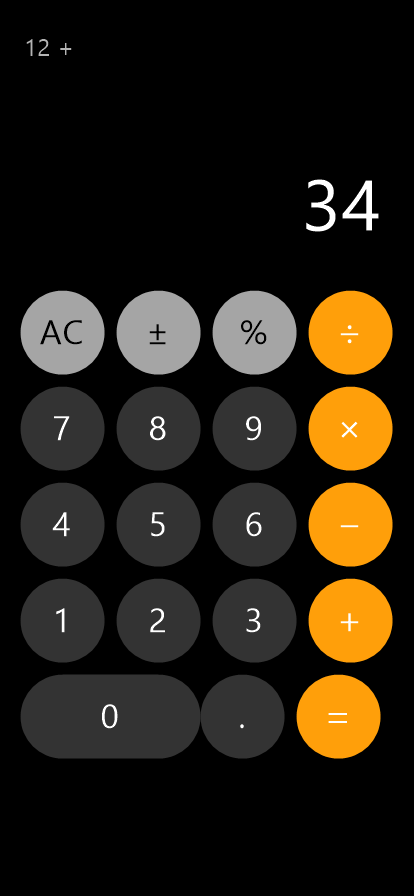

<div align="center">

# iOS Calculator for Android

[](LICENSE)
[](https://www.android.com/)
[](https://kotlinlang.org/)
[](https://developer.android.com/studio/releases/platforms)

**A pixel-perfect iOS-style calculator built with native Android Kotlin.**

一款用原生安卓 Kotlin 开发的、像素级复刻苹果 iOS 风格的计算器 App。

</div>

---

## 📱 Screenshots / 截图

| Portrait (Basic) / 竖屏（基础） | Landscape (Scientific) / 横屏（科学） |
|:---:|:---:|
|  |  |

---

## ✨ Features / 功能特性

### English
- **Pixel-perfect iOS design** — Dark background, rounded buttons, iOS color scheme (digits `#333333`, function `#A5A5A5`, operators `#FF9F0A`)
- **Portrait mode** — Classic 4-column keypad: AC / ± / % / ÷, 7 8 9 ×, 4 5 6 −, 1 2 3 +, 0 (wide) . =
- **Landscape mode** — Scientific panel with sin, cos, tan, ln, log, √, x², x³, 1/x, π, e, rand, EE, and parentheses `( )`
- **iOS "immediate calculation" model** — `2 + 3 = 5`, press `=` again to repeat (`5 =` → `8`); `5 + =` → `10`; division by zero shows "Error"
- **Trigonometric functions in degrees** (matching iOS behavior)
- **Auto orientation** — Switches between basic and scientific layouts automatically
- **Wide "0" button** in pill shape, just like iOS

### 中文
- **像素级复刻 iOS 设计** — 纯黑背景、圆角按键、iOS 配色（数字 `#333333`、功能键 `#A5A5A5`、运算符 `#FF9F0A`）
- **竖屏模式** — iOS 经典 4 列按键：AC / ± / % / ÷、7 8 9 ×、4 5 6 −、1 2 3 +、0(宽) . =
- **横屏模式** — 科学函数面板：sin、cos、tan、ln、log、√、x²、x³、1/x、π、e、rand、EE 及括号 `( )`
- **iOS 「即时运算」模型** — `2 + 3 = 5`，再按 `=` 重复运算（`5 =` → `8`）；`5 + =` → `10`；除以 0 显示"错误"
- **三角函数为角度制**（与 iOS 一致）
- **自动旋转** — 横竖屏自动切换基础/科学版布局
- **0 键为加宽药丸样式**，与 iOS 一致

---

## 🛠 Requirements / 环境要求

- **Android Studio** Hedgehog (2023.1.1) or later
- **JDK** 17 or later
- **Android SDK** Platform 34, Build-Tools 34.0.0
- **Gradle** 8.7
- **Kotlin** 1.9.24
- **Min SDK**: 24 (Android 7.0)
- **Target SDK**: 34 (Android 14)

---

## 🚀 Build & Run / 构建与运行

### Using Android Studio / 使用 Android Studio
1. Clone this repository
2. Open the project in Android Studio
3. Wait for Gradle sync to complete
4. Click **Run** (▶) or press `Shift+F10`

### Using Command Line / 使用命令行

> **Note:** Android build fails on paths containing Chinese characters (D8 crash). Build from a pure-English path.

```bash
# Clone the repository
git clone https://github.com/wsk130181-bot/ios-style-calculator-android.git
cd ios-style-calculator-android

# Build release APK
./gradlew assembleRelease

# Or build debug APK
./gradlew assembleDebug
```

The built APK will be at:
`app/build/outputs/apk/release/app-release-unsigned.apk`

### Install to device / 安装到设备

```bash
adb install app/build/outputs/apk/debug/app-debug.apk
```

---

## 📁 Project Structure / 项目结构

```
ios-style-calculator-android/
├── app/
│   ├── build.gradle.kts              # App module config (namespace, SDK versions)
│   ├── proguard-rules.pro
│   └── src/main/
│       ├── AndroidManifest.xml
│       ├── java/com/example/ioscalculator/
│       │   ├── CalculatorEngine.kt   # Calculation engine (iOS-style + scientific)
│       │   └── MainActivity.kt       # UI, orientation handling
│       └── res/
│           ├── layout/activity_main.xml       # Portrait layout
│           ├── layout-land/activity_main.xml  # Landscape layout
│           ├── drawable/   btn_num.xml, btn_num_wide.xml, btn_fn.xml, btn_op.xml, btn_sci.xml
│           ├── values/     colors.xml, strings.xml, themes.xml
│           └── mipmap-*/   ic_launcher.png
├── build.gradle.kts                  # Root build config (AGP 8.5.2, Kotlin 1.9.24)
├── settings.gradle.kts               # Repositories (Aliyun mirror + Google + Maven Central)
├── gradle.properties
├── docs/images/                      # Screenshots
├── LICENSE
├── README.md
├── CHANGELOG.md
├── SECURITY.md
├── CONTRIBUTING.md
└── .gitignore
```

---

## 🧮 How It Works / 计算原理

The `CalculatorEngine` implements iOS's "immediate calculation" model:

- **Basic operations** follow iOS behavior: pressing an operator evaluates the pending operation immediately.
- **Repeating `=`** after `2 + 3 =` gives `8` (adds 3 again).
- **`5 + =`** gives `10` (uses the current value as the right operand).
- **Division by zero** returns "错误" (Error).
- **Scientific functions** (sin, cos, tan) use degrees, not radians, matching iOS.

---

## 📜 License / 开源协议

This project is licensed under the **MIT License** — see the [LICENSE](LICENSE) file for details.

本项目使用 **MIT License** 开源协议，详见 [LICENSE](LICENSE) 文件。

---

## 🤝 Contributing / 参与贡献

Contributions are welcome! Please read [CONTRIBUTING.md](CONTRIBUTING.md) for details on our code of conduct and the process for submitting pull requests.

欢迎贡献！请阅读 [CONTRIBUTING.md](CONTRIBUTING.md) 了解贡献流程和行为准则。

---

## 📝 Changelog / 更新日志

See [CHANGELOG.md](CHANGELOG.md) for a list of changes.

详见 [CHANGELOG.md](CHANGELOG.md)。

---

## 🔒 Security / 安全

If you discover a security vulnerability, please report it via the process described in [SECURITY.md](SECURITY.md).

如发现安全漏洞，请按 [SECURITY.md](SECURITY.md) 中的流程报告。
